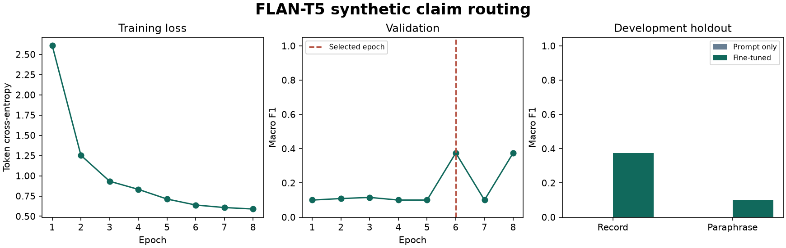

# FLAN-T5 claim routing model card

This CPU experiment tests whether fine-tuning a small sequence-to-sequence model improves routing on synthetic claim records. Each record has a simulation limit, a submitted amount, an invoice flag, and two procedure codes. The four outcomes are `review clear`, `escalate invoice`, `escalate code`, and `escalate amount`. The existing checklist generates the target labels and handles application routing.

## Data and training

The lab expands 20 synthetic development claims into 240 examples. A fixed split by original claim ID gives 144 training, 48 validation, and 48 holdout examples. Each split contains all four labels in equal proportions. The holdout includes a record format and a paraphrase that reorders the same facts. Both forms use the same underlying 48 examples. The final evaluation set is separate and stayed sealed.

The base is [FLAN-T5 Small at a pinned revision](https://huggingface.co/google/flan-t5-small/tree/0fc9ddf78a1e988dac52e2dac162b0ede4fd74ab), licensed under Apache 2.0. The [download manifest](../data/manifests/flan-t5-small.json) verifies the seven local files. The fast T5 tokenizer maps each input and target sequence to token IDs. The encoder and decoder look up those IDs in a shared 32,128-by-512 embedding table. Fine-tuning uses teacher-forced token cross-entropy through the encoder-decoder model.

Training updates the last decoder block and final decoder normalization, 3,147,776 of 76,961,152 parameters. The run used AdamW with a 0.0006 learning rate, a batch of eight, and seed 1808 for eight epochs. Training loss fell from 2.6101 to 0.5896. Epoch 6 was the first to reach the best validation macro F1 (0.375). Its updated tensors are saved as a local safetensors adapter.

## Development holdout

The main comparison uses identical prompts and greedy decoding before and after fine-tuning. A post-hoc diagnostic ranks the four allowed labels by mean token log likelihood, including the end token. It measures label selection when output formatting is guaranteed.

| Model and input | Greedy exact match | Greedy macro F1 | Greedy invalid | Closed-label exact match | Closed-label macro F1 |
| --- | ---: | ---: | ---: | ---: | ---: |
| Prompt only, record | 0/48 | 0.000 | 48 | 12/48 | 0.100 |
| Fine-tuned, record | 24/48 | 0.375 | 0 | 24/48 | 0.378 |
| Prompt only, paraphrase | 0/48 | 0.000 | 48 | 12/48 | 0.100 |
| Fine-tuned, paraphrase | 12/48 | 0.100 | 0 | 12/48 | 0.100 |

Greedy fine-tuning correctly routed all missing-invoice records and code discrepancies but sent every clear record and amount discrepancy to the code queue. On the paraphrase, both closed-label models and the fine-tuned greedy model always selected the invoice queue. The examples reuse a small number of base templates and contain at most one issue. Results apply to this synthetic lab. The adapter is unsuitable for routing real claims or for use in the policy-answer path.



The [numerical report](../evals/results/finetune.json) includes split hashes, dependency versions, label token IDs, training history, confusion matrices, and per-example outputs.

## Reproduce

The run used Python 3.12 and four CPU threads. Downloading the verified base requires about 311 MB. Training and scoring can run offline after the download.

```bash
python3 -m pip install -e '.[finetune]'
python3 -m careops.finetune.benchmark fetch-model
OMP_NUM_THREADS=4 OPENBLAS_NUM_THREADS=4 HF_HUB_OFFLINE=1 \
  python3 -m careops.finetune.benchmark train \
  --adapter models/flan-t5-claim-routing.safetensors \
  --figure /tmp/careops-finetune.png > /tmp/careops-finetune.json
OMP_NUM_THREADS=4 HF_HUB_OFFLINE=1 \
  python3 -m careops.finetune.benchmark score-adapter models/flan-t5-claim-routing.safetensors
```

The base weights and trained adapter stay in the ignored `models/` directory.
